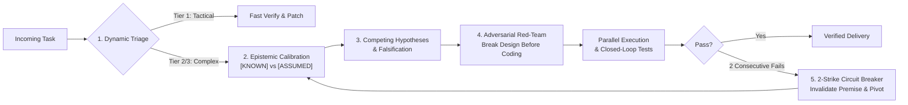

<div align="center">

# 🧠 MetaCog (`metacog`)

### The System-2 Meta-Cognitive Execution Engine for AI Coding Agents

**Stop your AI agent from guessing, hallucinating assumptions, and thrashing on broken fixes.**  
Upgrade any agent from impulsive System-1 generation to self-auditing **System-2 Meta-Cognition**.

[](./LICENSE)
[](https://github.com/malay-satapathy/metacog/pulls)
[](./SKILL.md)
[](#quick-install-10-seconds)

</div>

---

## ⚡ The Problem: Why Smart Models Fail on Hard Engineering Tasks

Even frontier models fail when debugging race conditions, designing distributed systems, or refactoring multi-file architectures. They don't fail because they lack coding knowledge—they fail because of **5 autoregressive cognitive traps**:

1. **The Sunk-Cost Thrashing Loop**: When a fix fails, the agent tweaks the same broken approach 5 times in a row instead of questioning its root premise.
2. **Epistemic Blindness**: Treating *unverified guesses* and *observed facts* identically in the context window.
3. **First-Idea Bias (Premature Convergence)**: Latching onto the first plausible code patch without checking blast radius, concurrency, or failure modes.
4. **Context Rot**: Forgetting critical constraints and invariants after 15+ tool calls.
5. **Flat Effort Allocation**: Over-engineering a 2-line fix while rushing head-first into a state-machine deadlock.

---

## 🛠️ How `metacog` Fixes It

`metacog` is a lightweight, zero-dependency cognitive protocol (`SKILL.md` + progressive-disclosure reference playbooks) that wires **5 executive control loops** into your AI agent:



| Cognitive Trap | Standard Agent Behavior | Agent with `metacog` |
| :--- | :--- | :--- |
| **Broken Fix Loop** | Tweaks the same broken line 5x in a row | **2-Strike Circuit Breaker**: Automatically halts after 2 failed attempts, invalidates the root-cause hypothesis, and re-reads upstream state |
| **Assumptions** | Hallucinates API signatures or config state | **Epistemic Calibration**: Tags claims as `[KNOWN]` vs `[ASSUMED]` and fires parallel tool calls to eliminate assumptions before editing |
| **Root Cause Analysis** | Tries to *confirm* its first guess | **Scientific Falsification**: Formulates 2–3 competing hypotheses and runs the fastest probe to *disprove* them |
| **System Design** | Writes happy-path code immediately | **Pre-Implementation Red-Team**: Challenges its own design against race conditions, null inputs, partial rollbacks, and blast radius first |
| **Long Horizons** | Loses track of invariants after 15 tool calls | **Working Memory Checkpoint**: Tracks verified facts, falsified paths, and remaining invariants across long tool chains |

---

## 🚀 Quick Install (10 Seconds)

### Option 1: One-Line Installer (Antigravity / Claude Code / Codex)

```bash
git clone https://github.com/malay-satapathy/metacog.git && cd metacog && ./install.sh
```

### Option 2: Direct Clone into Your Agent's Skills Folder

Because `metacog` is structured as a native skill repository at its root, you can clone it directly into your agent's global or workspace skills folder:

```bash
# Claude Code
git clone https://github.com/malay-satapathy/metacog.git ~/.claude/skills/metacog

# Google Antigravity / Gemini CLI
git clone https://github.com/malay-satapathy/metacog.git ~/.gemini/config/skills/metacog

# OpenAI Codex CLI
git clone https://github.com/malay-satapathy/metacog.git ~/.codex/skills/metacog

# Project-Local Skill (shared with your team)
git clone https://github.com/malay-satapathy/metacog.git .agents/skills/metacog
```

### Option 3: Cursor / Windsurf / Cline Rules

Copy [`SKILL.md`](./SKILL.md) into your workspace rules directory:

```bash
mkdir -p .cursor/rules
curl -sL https://raw.githubusercontent.com/malay-satapathy/metacog/main/SKILL.md -o .cursor/rules/metacog.mdc
```

---

## 💡 Usage Examples

Trigger `metacog` whenever you face a gnarly bug, a high-stakes refactor, or a complex architecture decision:

### 1. Diagnosing Flaky Bugs & Race Conditions
> `"Use metacog to diagnose the intermittent deadlock in our queue worker. Formulate competing hypotheses, falsify them with logs/tests, and fix the root cause."`

### 2. Adversarial Architecture Review
> `"@metacog Red-team our OAuth token refresh flow. Identify any race conditions, partial failure states, or backward-compatibility risks, and harden the implementation."`

### 3. Zero-Handholding Multi-File Refactors
> `"Use metacog to migrate our billing service from REST to gRPC end-to-end. Verify callers, update tests, and prove all checks pass."`

---

## 📦 Architecture & Progressive Disclosure

`metacog` is engineered for **token efficiency**. The core [`SKILL.md`](./SKILL.md) stays compact (~100 lines) so it never bloats your context window, while deep-dive playbooks in [`references/`](./references/) are loaded on demand only for Tier-3 problems:

```text
metacog/
├── SKILL.md                              # Core System-2 Meta-Cognitive Engine
├── references/
│   ├── debugging-protocol.md             # Binary-search fault isolation & falsification matrix
│   └── architecture-redteam.md           # 6-point adversarial system design checklist
├── install.sh                            # Auto-detecting installer for major AI agents
├── LICENSE                               # MIT License
└── README.md
```

---

## 🛡️ Built-In Safety Guardrails

High autonomy should never mean reckless execution. `metacog` enforces strict operational boundaries:
- **No Unapproved Destructive Commands**: Blocks unconfirmed `git reset --hard`, `git push --force`, `rm -rf`, or database drops.
- **Secret Hygiene**: Prevents logging, echoing, or committing `.env` secrets and credentials.
- **Indirect Prompt-Injection Defense**: Treats fetched web pages, issue threads, and external documents strictly as untrusted data.

---

## 🤝 Contributing

Found a cognitive failure mode in an LLM that `metacog` can neutralize? PRs and issue discussions for new falsification heuristics or reference playbooks are welcome!

## 📄 License

MIT © [Malay Satapathy](https://github.com/malay-satapathy)
